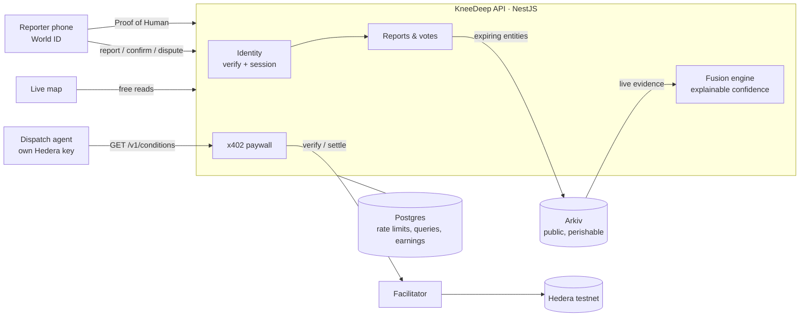

# KneeDeep

**Street-level truth for AI agents: verified, perishable, paid.**

Weather APIs tell an agent it rained. KneeDeep tells it the Andheri subway is knee-deep _right now_,
from three verified humans 20 minutes ago, and pays those humans for it.

KneeDeep is a paid, real-time API of street-level conditions (waterlogging, blocked roads) reported by
verified humans. Reports expire because street truth expires. Delivery, logistics and dispatch agents
pay per query via x402 on Hedera, and the reporters whose corroborated reports were used get paid.

Built at ETHGlobal Mumbai 2026 for **Hedera** (AI Agents That Pay: x402), **Arkiv** and **World**.

> Demo data is simulated and labelled `source: simulated` everywhere: on Arkiv, in API answers and on
> the map (dashed markers). Only World ID-verified reports are ever `live`.

## How it works



1. **Report.** A reporter proves once, with World ID Proof of Human, that they are a unique person, then
   picks a level (dry / ankle / knee / waist / road closed) and shares a location. The report is written
   to Arkiv with a 3-hour expiry, located only by its ~150 m cell.
2. **Confirm or dispute.** Verified humans within 1 km vote on live reports. Each vote is its own Arkiv
   entity and expires with its report.
3. **Query and pay.** An agent calls `GET /v1/conditions?lat&lng&radius`, gets `402`, pays 0.1 HBAR via
   x402 on Hedera with no human approval, and receives a level per cell with a confidence score and the
   evidence behind it.
4. **Earn** _(in progress)_. Reporters whose corroborated reports were used in paid answers are paid in
   one batched Hedera transfer. Each paid query already records which reports it used.

Design rationale (expiry, confidence formula, anti-gaming, privacy): [docs/design.md](docs/design.md).

## Quick start

Requirements: Node 22.12+ (`.nvmrc`), Docker, a Hedera testnet account
([portal.hedera.com](https://portal.hedera.com)), an Arkiv access key
([hub.arkiv.network](https://hub.arkiv.network/access-keys)), a World ID app
([developer.world.org](https://developer.world.org)).

```bash
npm install
cp .env.example .env          # fill in keys; see comments in the file
npm run db:up && npm run db:migrate

npm run arkiv:wallet          # prints ARKIV_PRIVATE_KEY + address; fund it at hub.arkiv.network/faucet
npm run arkiv:smoke           # writes one expiring report to Arkiv and reads it back
npm run hedera:balance        # balances print, keys match, facilitator supports hedera:testnet

npm run dev                   # API on :3000, web on :5173 (Vite proxies /v1 to the API)
```

Open http://localhost:5173. `GET /health` shows Postgres, Arkiv and Hedera status.

## Trying it end to end

**Without a phone (dev mode).** Set `REPORTER_VERIFIER=dev`: identities are free and everything they
write is labelled simulated.

```bash
npm run simulate              # 3 knee-deep reports at Andheri subway, 1 confirmation, 1 ankle report
npm run agent                 # discovers the API, pays via x402, prints the answer + HashScan link
```

On the map: click a marker to confirm or dispute it, click anywhere to report there, click an agent query
to fly to it. Every report links to its entity on the Arkiv explorer.

**With World ID.** Set `REPORTER_VERIFIER=world`.

- _Simulator:_ `WORLD_ENVIRONMENT=staging`. In the [World ID simulator](https://simulator.worldcoin.org)
  create an identity and give it an Orb credential, then click **Verify** in the app and paste the QR link
  into the simulator.
- _World App:_ `WORLD_ENVIRONMENT=production`, then scan the QR with World App.
- If World App returns a legacy 3.0 proof (the error says so), set `WORLD_ALLOW_LEGACY_PROOFS=true`.

**Truth expires.** Set `REPORT_TTL_SECONDS=120`, simulate, query, wait two minutes, query again: the answer
becomes `"dataStatus": "empty"`.

## API

| Endpoint                            | Auth               | What                                                                   |
| ----------------------------------- | ------------------ | ---------------------------------------------------------------------- |
| `GET /v1`                           | none               | Catalog: what is for sale and the price                                |
| `GET /v1/conditions?lat&lng&radius` | **x402**, 0.1 HBAR | Fused level per ~150 m cell, confidence, and the inputs behind it      |
| `GET /v1/reports?lat&lng&radius`    | none               | Raw live reports with votes, expiry and Arkiv links                    |
| `GET /v1/activity`                  | none               | Recent agent queries: answer, payment, HashScan link                   |
| `GET /v1/identity/context`          | none               | Signed IDKit request context (the RP signing key stays on the server)  |
| `POST /v1/identity/session`         | proof              | Exchange a World ID Proof of Human for a reporter session: `{ proof }` |
| `GET /v1/identity/me`               | session            | Whether a stored session is still valid                                |
| `POST /v1/reports`                  | session            | Submit a report: `{ level, lat, lng }`                                 |
| `POST /v1/reports/:key/votes`       | session            | Confirm or dispute: `{ vote, lat, lng }`; within 1 km, once per report |
| `GET /health`, `GET /health/live`   | none               | Readiness (Postgres, Arkiv, Hedera) and liveness                       |

Sessions are sent as `Authorization: Bearer <token>`. Errors share one shape:
`{ statusCode, error, message, requestId }`, and every response carries an `x-request-id` header.

Example paid answer:

```json
{
  "dataStatus": "simulated",
  "notices": ["Includes SIMULATED demo data, not real observations."],
  "areas": [
    {
      "cell": "te7uc8t",
      "distanceM": 54,
      "level": "knee",
      "confidence": 0.78,
      "confidenceLabel": "high",
      "explanation": "4 independent humans report knee-deep water; newest just now, oldest 1 min ago; 2 confirmations, 1 dispute.",
      "inputs": {
        "supportingHumans": 4,
        "reports": 3,
        "contradictingReports": 0,
        "confirmations": 2,
        "disputes": 1,
        "newestAgeMin": 0.9,
        "oldestAgeMin": 1.3
      }
    }
  ]
}
```

## Payment flow (x402 on Hedera)

```
agent                         KneeDeep API                       facilitator (Blocky402)      Hedera
  | GET /v1  (free catalog)       |                                    |                        |
  | GET /v1/conditions ---------->| 402 + PAYMENT-REQUIRED             |                        |
  | sign HBAR transfer (own key)  |                                    |                        |
  | GET + PAYMENT-SIGNATURE ----->| verify ------------------------->  |                        |
  |                               | build answer, record query         |                        |
  |                               | settle ------------------------->  | submit, pay fee ---->  |
  | 200 + answer + PAYMENT-RESPONSE (tx id)  <-- mark query paid       |                        |
```

- The agent pays from its own Hedera account. No human approves a payment; a per-query cap
  (`AGENT_MAX_TINYBARS_PER_QUERY`) bounds what it will sign.
- If the API answers 4xx/5xx, settlement is cancelled: invalid queries are never charged.
- Every paid query is stored with its settled Hedera transaction id.

## Data on Arkiv

Every report and vote is a public, expiring entity on Arkiv's Rabdi testnet, owned by the KneeDeep
writer: [`0x17caA788b2229bDF7F4E057191E62CF7f7bD2085`](https://rabdi.explorer.arkiv.network/address/0x17caA788b2229bDF7F4E057191E62CF7f7bD2085).
Schema: [arkiv/schema.md](arkiv/schema.md).

Read it without the KneeDeep API, with only the public SDK and the writer address:

```bash
npm run arkiv:query                                                        # Mumbai (geohash te7…)
npm run arkiv:query -- 0x17caA788b2229bDF7F4E057191E62CF7f7bD2085 te7uc8   # around Andheri
```

```ts
client
  .select({ $key: true, $expiresAt: true, level: true, cell: true, reportedAt: true, source: true })
  .from(Reports)
  .where(startsWith('cell', 'te7'))
  .ownedBy(WRITER)
  .orderBy(asc('$expiresAt'))
  .limit(100)
  .fetch();
```

## World ID

Proof of Human is verified on the server; the reporter then gets a 12-hour session carrying only a
salted-hash pseudonym. Why Proof of Human is the minimum sufficient credential, the rejection paths and
the integration debrief: [docs/WORLD_DEBRIEF.md](docs/WORLD_DEBRIEF.md).

## Production readiness

| Concern       | What is in place                                                                                                                                                                              |
| ------------- | --------------------------------------------------------------------------------------------------------------------------------------------------------------------------------------------- |
| Configuration | Validated at boot (zod). With `NODE_ENV=production` the API refuses dev identities, staging World ID, placeholder secrets or missing keys.                                                    |
| Security      | Helmet headers, CORS allowlist, 64 KB body limit, per-IP rate limits (tighter on identity and writes), RP signing key server-only, no internals in error bodies.                              |
| Abuse         | World ID uniqueness, one report per human per cell per 30 min (race-free reservation), one vote per human per report, votes only from within 1 km.                                            |
| Correctness   | Reports and votes reserve a Postgres row before the Arkiv write and release it on failure; Arkiv writes are serialised per wallet (nonce safety); settled payments are recorded idempotently. |
| Observability | Request ids on every response and log line; one log line per request; readiness and liveness endpoints.                                                                                       |
| Deployment    | One Docker image: the API serves the built web app. Migrations run on boot (`MIGRATE_ON_BOOT=true`) under an advisory lock.                                                                   |
| Quality       | 59 unit tests (fusion, identity, sessions, report/vote rules, config, geo), ESLint, Prettier, CI on every push.                                                                               |

```bash
docker compose --profile app up --build      # Postgres + the app on http://localhost:8080
```

Known gaps: no Content-Security-Policy yet (the map tiles and World ID bridge need a tested policy);
rate limits are per process (use a shared store when running several replicas); no integration tests
against a live Arkiv or Hedera node in CI.

## Development

| Command               | What                                         |
| --------------------- | -------------------------------------------- |
| `npm run dev`         | API (watch) + web                            |
| `npm test`            | Unit tests                                   |
| `npm run lint`        | ESLint                                       |
| `npm run format`      | Prettier                                     |
| `npm run typecheck`   | TypeScript across api, web, agent            |
| `npm run build`       | Production builds                            |
| `npm run db:migrate`  | Apply migrations (`db:reset` drops all, dev) |
| `npm run simulate`    | Simulated reports through the API (dev mode) |
| `npm run agent`       | Paying dispatch agent                        |
| `npm run arkiv:query` | Read live data straight from Arkiv           |

| Folder            | What                                                                        |
| ----------------- | --------------------------------------------------------------------------- |
| [`api/`](api)     | NestJS API: identity, reports, votes, fusion engine, x402 paywall, activity |
| [`web/`](web)     | Vite + React: live map dashboard and mobile reporter page (Leaflet + OSM)   |
| [`agent/`](agent) | Deterministic dispatch agent that discovers, pays for and reads conditions  |
| [`arkiv/`](arkiv) | Arkiv submission notes: schema, friction log                                |
| [`docs/`](docs)   | Design decisions, World debrief, AI usage                                   |

## Privacy

- Locations are coarsened to geohash cells (~150 m) on the server; raw GPS is never stored or published.
- Public reporter IDs are `sha256(salt ‖ nullifier)`. The World ID nullifier is never stored.

## Limitations

- Testnet only (Hedera testnet, Arkiv Rabdi). Demo data is simulated and labelled so.
- World ID proves uniqueness, not truth: a verified human can still lie once. Corroboration and paying
  only for corroborated reports reduce the incentive; reporter reputation is future work.
- The backend writes to Arkiv on reporters' behalf, so reporters don't own their entries.

## Related work

Groundtruth (ETHGlobal Cannes 2026) is a verified intelligence map of world events
with World ID, corroboration and x402. KneeDeep differs in four ways: reports expire by design, reporters
are paid for data agents use, it targets one concrete decision (routing around street flooding), and it
settles on Hedera with data on Arkiv.

## AI usage

See [docs/AI_USAGE.md](docs/AI_USAGE.md).

## License

MIT
