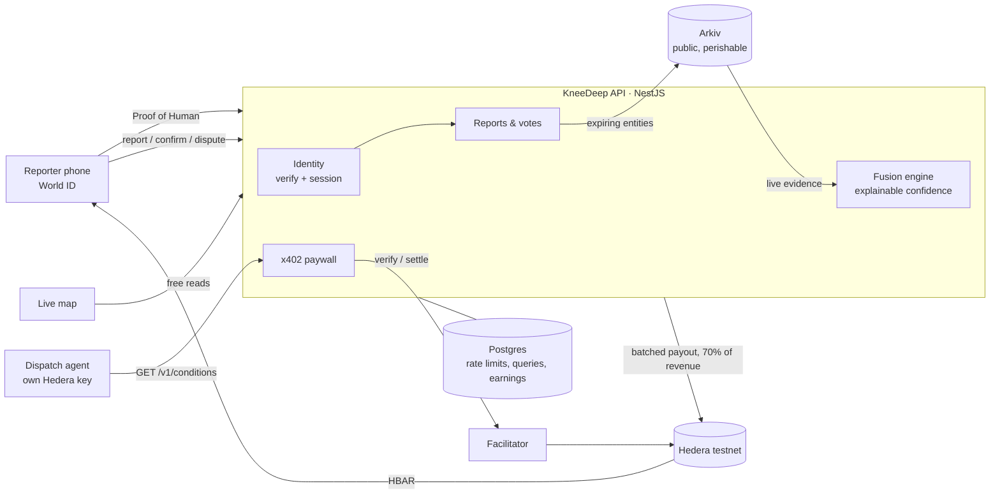

# KneeDeep

**Street-level truth for AI agents: verified, perishable, paid.**

Weather APIs tell an agent it rained. KneeDeep tells it the Andheri subway is knee-deep _right now_,
from three verified humans 20 minutes ago, and pays those humans for it.

KneeDeep is a paid, real-time API of street-level conditions (waterlogging, blocked roads) reported by
verified humans. Reports expire because street truth expires. Delivery, logistics and dispatch agents
pay per query via x402 on Hedera, and the reporters whose corroborated reports were used get paid.

Built at ETHGlobal Mumbai 2026 for **Hedera** (AI Agents That Pay: x402), **Arkiv** and **World**.

> Demo data is simulated and labelled `source: simulated` everywhere: on Arkiv, in API answers and on
> the map (dashed markers). Only World ID-verified reports are ever `live`.

## How it works



1. **Report.** A reporter proves once, with World ID Proof of Human, that they are a unique person, then
   picks a level (dry / ankle / knee / waist / road closed) and shares a location. The report is written
   to Arkiv with a 3-hour expiry, located only by its ~150 m cell.
2. **Confirm or dispute.** Verified humans within 1 km vote on live reports. Each vote is its own Arkiv
   entity and expires with its report.
3. **Query and pay.** An agent calls `GET /v1/conditions?lat&lng&radius`, gets `402`, pays 0.1 HBAR via
   x402 on Hedera with no human approval, and receives a level per cell with a confidence score and the
   evidence behind it.
4. **Decide.** The dispatch agent pays for every checkpoint on both candidate routes and takes the safer
   one, explaining why (knee-deep or worse is impassable for a scooter; no data is never "dry").
5. **Earn.** 70% of every paid query is credited to the verified humans whose live reports it used, if
   another verified human corroborated them. Earnings go out in **one batched Hedera transfer** to every
   reporter's own account. Simulated data never earns.

Design rationale (expiry, confidence formula, anti-gaming, privacy): [docs/design.md](docs/design.md).

## Quick start

Requirements: Node 22.12+ (`.nvmrc`), Docker, a Hedera testnet account
([portal.hedera.com](https://portal.hedera.com)), an Arkiv access key
([hub.arkiv.network](https://hub.arkiv.network/access-keys)), a World ID app
([developer.world.org](https://developer.world.org)).

```bash
npm install
cp .env.example .env          # fill in keys; see comments in the file
npm run db:up && npm run db:migrate

npm run arkiv:wallet          # prints ARKIV_PRIVATE_KEY + address; fund it at hub.arkiv.network/faucet
npm run arkiv:smoke           # writes one expiring report to Arkiv and reads it back
npm run hedera:balance        # balances print, keys match, facilitator supports hedera:testnet

npm run dev                   # API on :3000, web on :5173 (Vite proxies /v1 to the API)
```

Open http://localhost:5173. `GET /health` shows Postgres, Arkiv and Hedera status.

**Or run everything in Docker** (Postgres + API + web app on one port, no Node tooling needed at runtime):

```bash
cp .env.example .env          # fill in keys
npm run docker:up             # http://localhost:8080: home, /map, /report, /me
npm run docker:logs           # follow the app's logs
npm run docker:down           # stop (add -v to docker compose down to wipe the database)
```

The container runs as the **staging** tier: production build and strict checks (real secrets, World ID
required, dev identities refused), with World ID on the simulator and testnets. A `STAGING` badge shows in
the header. Use `DOCKER_APP_ENV=production npm run docker:up` for real World App only, or
`DOCKER_APP_ENV=development` for the lenient tier. Tiers are described in `.env.example` (`APP_ENV`).
Run the agent against the container with `npm run demo:agent` (it sets `KNEEDEEP_API_URL=http://localhost:8080`).

## Demo: one command

```bash
npm run demo
```

Builds and starts everything in Docker (Postgres + API + web app on http://localhost:8080, staging tier),
writes a **simulated monsoon evening** to Arkiv, then runs an end-to-end check against the real
services and prints PASS/FAIL per step:

| Area     | What is checked                                                                                                                                                                                                                                                         |
| -------- | ----------------------------------------------------------------------------------------------------------------------------------------------------------------------------------------------------------------------------------------------------------------------- |
| Platform | Readiness (Postgres, Arkiv, Hedera), web app served, catalog and price                                                                                                                                                                                                  |
| World ID | Server-signed IDKit context; no session, a bot's dev identity and a forged proof (sent to World's verify API) are all refused, and nothing is written                                                                                                                   |
| Arkiv    | Demo scenario written; the API serves it; the same data is readable straight from Arkiv                                                                                                                                                                                 |
| Hedera   | Unpaid query gets 402; the agent pays with its own key and gets "knee, high" at Andheri; the mirror node confirms the settlement; simulated reports earn nothing; the clear route reads dry; the dashboard shows the HashScan link; an invalid paid query costs nothing |
| Agent    | Pays for all 6 checkpoints on both routes and picks the dry Western Express Highway over flooded S.V. Road                                                                                                                                                              |
| Expiry   | A report vanishes from Arkiv and the API when it expires, with no cleanup job (2-3 min)                                                                                                                                                                                 |

It spends 0.8 testnet HBAR from the agent (0.2 with `--quick`). Re-run checks only with `npm run demo:check`
(`-- --quick` skips the expiry wait, `-- --no-seed` skips the scenario). Refresh the scenario alone with
`npm run demo:seed`. The scenario follows the agent's two routes: S.V. Road via the subways is flooded
(Khar ankle, Milan waist, Andheri knee), the Western Express Highway is dry. Every entry is labelled
`simulated`.

## Trying it end to end

**Without a phone (dev mode).** Set `REPORTER_VERIFIER=dev`: identities are free and everything they
write is labelled simulated.

```bash
npm run simulate              # 3 knee-deep reports at Andheri subway, 1 confirmation, 1 ankle report
npm run agent                 # pays for 6 checkpoints on 2 routes via x402, picks the safer route
```

On the map: click a marker to confirm or dispute it, click anywhere to report there, click an agent query
to fly to it. Every report links to its entity on the Arkiv explorer.

**With World ID.** Set `REPORTER_VERIFIER=world`.

- _Simulator:_ `WORLD_ENVIRONMENT=staging`. In the [World ID simulator](https://simulator.worldcoin.org)
  create an identity and give it an Orb credential, then click **Verify** in the app and paste the QR link
  into the simulator.
- _World App:_ `WORLD_ENVIRONMENT=production`, then scan the QR with World App.
- If World App returns a legacy 3.0 proof (the error says so), set `WORLD_ALLOW_LEGACY_PROOFS=true`.

**Confirm and dispute from anywhere.** Votes need you within 1 km of the report. Outside production, the
top bar has a **test location** picker (e.g. Andheri subway): reporting, voting and the map then use that
spot instead of GPS, and the map shows it with the 1 km voting circle. Production always uses real GPS
(the server cannot verify GPS either way: the 1 km rule keeps honest clients local, it is not a proof).
You cannot vote on your own report: vote on the seeded ones (`npm run demo:seed`) or use a second
simulator identity in another browser profile.

**Reporter payouts end to end** (two World ID simulator identities, A and B, in two browser profiles,
both with the test location set to Andheri subway):

1. A and B each verify, open `/report`, share location and report **Knee** (or B confirms A's report).
   Two live humans agreeing makes both reports corroborated.
2. Each opens **My activity** (`/me`), adds a Hedera testnet account under **Earnings and payouts** (any
   account that is not the platform's), and sees the other's report under **Reports to confirm or
   dispute**.
3. `npm run demo:agent`: the agent pays for Andheri subway (and 5 other checkpoints). Each paid answer
   that used A's and B's reports credits them 70% of 0.1 HBAR, split equally: "owed" goes up.
4. `npm run payout`: one Hedera transfer pays both. The HashScan link appears in the CLI, under
   **My activity** (per report: paid answers used in, amount earned) and in **Reporter payouts** on the
   map. Run it again: nothing is paid twice.

The API also runs a batch every `PAYOUT_INTERVAL_MINUTES` (default 60; 0 = only on demand).

**Truth expires.** Set `REPORT_TTL_SECONDS=120`, simulate, query, wait two minutes, query again: the answer
becomes `"dataStatus": "empty"`.

## API

| Endpoint                              | Auth               | What                                                                              |
| ------------------------------------- | ------------------ | --------------------------------------------------------------------------------- |
| `GET /v1`                             | none               | Catalog: what is for sale and the price                                           |
| `GET /v1/conditions?lat&lng&radius`   | **x402**, 0.1 HBAR | Fused level per ~150 m cell, confidence, and the inputs behind it                 |
| `GET /v1/reports?lat&lng&radius`      | none               | Raw live reports with votes, expiry and Arkiv links                               |
| `GET /v1/activity`                    | none               | Recent agent queries (answer, payment, HashScan) and reporter payouts             |
| `GET /v1/identity/context`            | none               | Signed IDKit request context (the RP signing key stays on the server)             |
| `POST /v1/identity/session`           | proof              | Exchange a World ID Proof of Human for a reporter session: `{ proof }`            |
| `GET /v1/identity/me`                 | session            | Whether a stored session is still valid                                           |
| `POST /v1/reports`                    | session            | Submit a report: `{ level, lat, lng }`                                            |
| `POST /v1/reports/:key/votes`         | session            | Confirm or dispute: `{ vote, lat, lng }`; within 1 km, once per report            |
| `GET /v1/reporters/me`                | session            | Your earnings: owed, being paid, paid, payout transactions                        |
| `GET /v1/reporters/me/activity`       | session            | Your reports (live and expired, votes received, paid answers, earned), your votes |
| `PUT /v1/reporters/me/payout-account` | session            | `{ accountId: "0.0.x" \| null }`; checked on the mirror node                      |
| `GET /health`, `GET /health/live`     | none               | Readiness (Postgres, Arkiv, Hedera) and liveness                                  |

Sessions are sent as `Authorization: Bearer <token>`. Errors share one shape:
`{ statusCode, error, message, requestId }`, and every response carries an `x-request-id` header.

Example paid answer:

```json
{
  "dataStatus": "simulated",
  "notices": ["Includes SIMULATED demo data, not real observations."],
  "areas": [
    {
      "cell": "te7uc8t",
      "distanceM": 54,
      "level": "knee",
      "confidence": 0.78,
      "confidenceLabel": "high",
      "explanation": "4 independent humans report knee-deep water; newest just now, oldest 1 min ago; 2 confirmations, 1 dispute.",
      "inputs": {
        "supportingHumans": 4,
        "reports": 3,
        "contradictingReports": 0,
        "confirmations": 2,
        "disputes": 1,
        "newestAgeMin": 0.9,
        "oldestAgeMin": 1.3
      }
    }
  ]
}
```

## Payment flow (x402 on Hedera)

```
agent                         KneeDeep API                       facilitator (Blocky402)      Hedera
  | GET /v1  (free catalog)       |                                    |                        |
  | GET /v1/conditions ---------->| 402 + PAYMENT-REQUIRED             |                        |
  | sign HBAR transfer (own key)  |                                    |                        |
  | GET + PAYMENT-SIGNATURE ----->| verify ------------------------->  |                        |
  |                               | build answer, record query         |                        |
  |                               | settle ------------------------->  | submit, pay fee ---->  |
  | 200 + answer + PAYMENT-RESPONSE (tx id)  <-- mark query paid       |                        |
```

- The agent pays from its own Hedera account. No human approves a payment; a per-query cap
  (`AGENT_MAX_TINYBARS_PER_QUERY`) bounds what it will sign.
- If the API answers 4xx/5xx, settlement is cancelled: invalid queries are never charged.
- Every paid query is stored with its settled Hedera transaction id.
- The agent also has a per-trip budget (`AGENT_MAX_TINYBARS_PER_TRIP`): it prices the whole trip from
  the catalog and refuses to start if checking every checkpoint would exceed it.

### Reporter payouts

```
paid query settles ──> credit 70% to its earning reporters (same DB transaction as "paid")
payout batch:  lock ─> resolve any batch still in flight (mirror node, by tx id)
               ─> plan: unpaid earnings per payout account (≥ PAYOUT_MIN_TINYBARS, ≤ 9 accounts)
               ─> COMMIT batch row + pre-generated Hedera tx id + claimed earnings
               ─> ONE TransferTransaction: platform −total, each reporter +amount, memo = batch id
               ─> receipt SUCCESS: settled · definite failure: released to the next batch
```

- **Who earns:** a live report (World ID verified), used in a paid answer, corroborated by another live
  human (a matching report or a confirmation). Each human is credited once per query; rounding dust stays
  with the platform. Unpaid queries credit no one. Simulated data never earns and never makes a live
  report earn.
- **Idempotent by batch id:** the batch and its Hedera transaction id are committed before anything is
  sent, so a crash or timeout leaves a record that is resolved from the mirror node before any new batch.
  A transaction the network never saw within its 120 s validity window can never execute, so its
  earnings are safely released. A Postgres advisory lock serialises the API's schedule and
  `npm run payout`; at most one batch can be in flight (unique index).
- **Payout accounts** are checked on the mirror node (exists, not deleted, no receiver signature
  required) so one bad account cannot fail every batch.

## Data on Arkiv

Every report and vote is a public, expiring entity on Arkiv's Rabdi testnet, owned by the KneeDeep
writer: [`0x17caA788b2229bDF7F4E057191E62CF7f7bD2085`](https://rabdi.explorer.arkiv.network/address/0x17caA788b2229bDF7F4E057191E62CF7f7bD2085).
Schema: [arkiv/schema.md](arkiv/schema.md).

Read it without the KneeDeep API, with only the public SDK and the writer address:

```bash
npm run arkiv:query                                                        # Mumbai (geohash te7…)
npm run arkiv:query -- 0x17caA788b2229bDF7F4E057191E62CF7f7bD2085 te7uc8   # around Andheri
```

```ts
client
  .select({ $key: true, $expiresAt: true, level: true, cell: true, reportedAt: true, source: true })
  .from(Reports)
  .where(startsWith('cell', 'te7'))
  .ownedBy(WRITER)
  .orderBy(asc('$expiresAt'))
  .limit(100)
  .fetch();
```

## World ID

Proof of Human is verified on the server; the reporter then gets a 12-hour session carrying only a
salted-hash pseudonym. Why Proof of Human is the minimum sufficient credential, the rejection paths and
the integration debrief: [docs/WORLD_DEBRIEF.md](docs/WORLD_DEBRIEF.md).

## Production readiness

| Concern       | What is in place                                                                                                                                                                                                                                     |
| ------------- | ---------------------------------------------------------------------------------------------------------------------------------------------------------------------------------------------------------------------------------------------------- |
| Configuration | Validated at boot (zod). Deployment tiers (`APP_ENV`): in staging and production the API refuses dev identities, placeholder secrets or missing keys; production also refuses the World ID simulator.                                                |
| Security      | Helmet headers, CORS allowlist, 64 KB body limit, per-IP rate limits (tighter on identity and writes), RP signing key server-only, no internals in error bodies.                                                                                     |
| Abuse         | World ID uniqueness, one report per human per cell per 30 min (race-free reservation), one vote per human per report, votes only from within 1 km.                                                                                                   |
| Correctness   | Reports and votes reserve a Postgres row before the Arkiv write and release it on failure; Arkiv writes are serialised per wallet (nonce safety); settled payments are recorded idempotently; payout batches are idempotent by batch id (see above). |
| Observability | Request ids on every response and log line; one log line per request; readiness and liveness endpoints.                                                                                                                                              |
| Deployment    | One Docker image: the API serves the built web app. Migrations run on boot (`MIGRATE_ON_BOOT=true`) under an advisory lock.                                                                                                                          |
| Quality       | 84 unit tests (fusion, payout eligibility and arithmetic, identity, sessions, report/vote rules, config, geo, agent routing), ESLint, Prettier, CI on every push.                                                                                    |

```bash
npm run docker:up      # Postgres + the app on http://localhost:8080 (staging tier); npm run docker:down
```

Known gaps: no Content-Security-Policy yet (the map tiles and World ID bridge need a tested policy);
rate limits are per process (use a shared store when running several replicas); no integration tests
against a live Arkiv or Hedera node in CI.

## Development

| Command               | What                                          |
| --------------------- | --------------------------------------------- |
| `npm run dev`         | API (watch) + web                             |
| `npm test`            | Unit tests                                    |
| `npm run lint`        | ESLint                                        |
| `npm run format`      | Prettier                                      |
| `npm run typecheck`   | TypeScript across api, web, agent             |
| `npm run build`       | Production builds                             |
| `npm run db:migrate`  | Apply migrations (`db:reset` drops all, dev)  |
| `npm run simulate`    | Simulated reports through the API (dev mode)  |
| `npm run agent`       | Paying dispatch agent (`demo:agent` = Docker) |
| `npm run payout`      | Run one reporter payout batch now             |
| `npm run arkiv:query` | Read live data straight from Arkiv            |

| Folder            | What                                                                        |
| ----------------- | --------------------------------------------------------------------------- |
| [`api/`](api)     | NestJS API: identity, reports, votes, fusion engine, x402 paywall, activity |
| [`web/`](web)     | Vite + React: live map dashboard and mobile reporter page (Leaflet + OSM)   |
| [`agent/`](agent) | Deterministic dispatch agent: pays per checkpoint, picks the safer route    |
| [`arkiv/`](arkiv) | Arkiv submission notes: schema, friction log                                |
| [`docs/`](docs)   | Design decisions, World debrief, AI usage                                   |

## Privacy

- Locations are coarsened to geohash cells (~150 m) on the server; raw GPS is never stored or published.
- Public reporter IDs are `sha256(salt ‖ nullifier)`. The World ID nullifier is never stored.
- Payouts are public Hedera transfers. A reporter's payout account is stored next to their pseudonym and
  never published with their reports, but anyone can see that the account receives KneeDeep payouts.

## Limitations

- Testnet only (Hedera testnet, Arkiv Rabdi). Demo data is simulated and labelled so.
- World ID proves uniqueness, not truth: a verified human can still lie once. Corroboration and paying
  only for corroborated reports reduce the incentive; reporter reputation is future work.
- The backend writes to Arkiv on reporters' behalf, so reporters don't own their entries.
- One Hedera transfer carries at most 10 HBAR movements, so a batch pays up to 9 reporters (largest
  balances first); the rest wait for the next batch.
- Confirmations corroborate a report (so its author earns) but the confirmer is not paid for voting.

## Related work

Groundtruth (ETHGlobal Cannes 2026) is a verified intelligence map of world events
with World ID, corroboration and x402. KneeDeep differs in four ways: reports expire by design, reporters
are paid for data agents use, it targets one concrete decision (routing around street flooding), and it
settles on Hedera with data on Arkiv.

## AI usage

See [docs/AI_USAGE.md](docs/AI_USAGE.md).

## License

MIT
